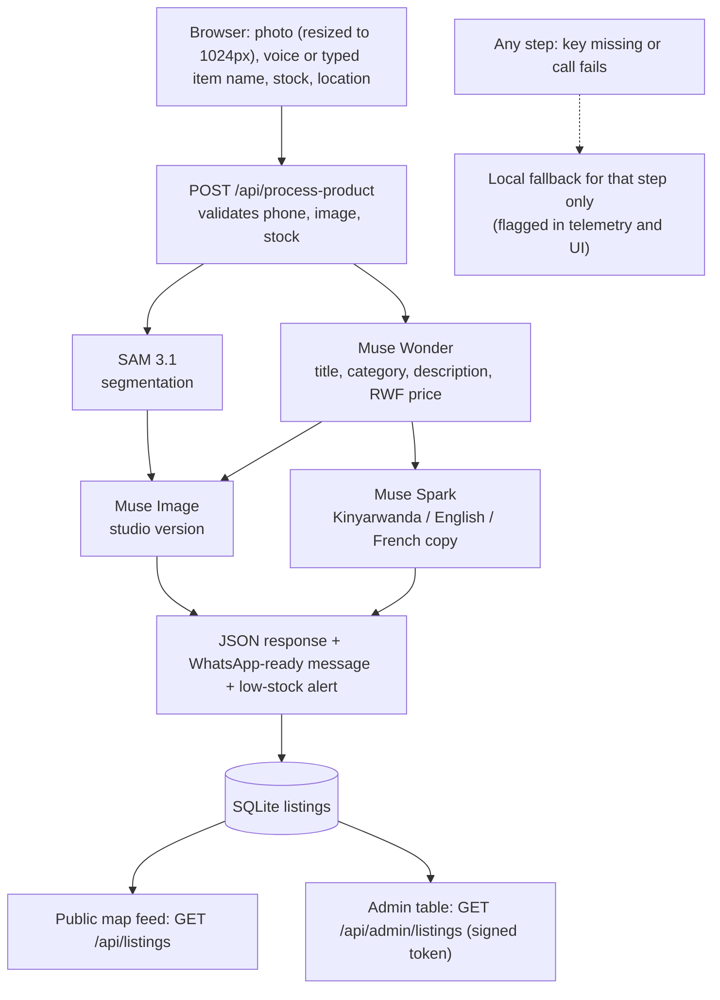

# Architecture and data flow

GitHub renders the Mermaid diagram below directly.

## Execution order

1. SAM 3.1 and Muse Wonder run in parallel (they only need the photo).
2. Muse Image and Muse Spark run in parallel (they only need the Muse Wonder result).

## Fallbacks

Each step falls back independently, so one failing call does not discard the others.
Every step reports `{model, source, fallback, ms, error}`.

| Step | Fallback behaviour |
|---|---|
| SAM 3.1 | Returns `mask_isolated: false`. No fake confidence value. |
| Muse Wonder | Pillow colour/brightness read plus keyword price guess. Description says it is basic local analysis. |
| Muse Image | Pillow auto-contrast and light sharpening. |
| Muse Spark | Template copy in the three languages. |

## Separate routes

- `POST /api/ussd-fallback`: simulated *250# menu (low-stock option reads the database).
- `POST /api/whatsapp-webhook`: simulator returning the message that would be sent.
- `GET /api/status`: shows whether the Meta API key is configured.
